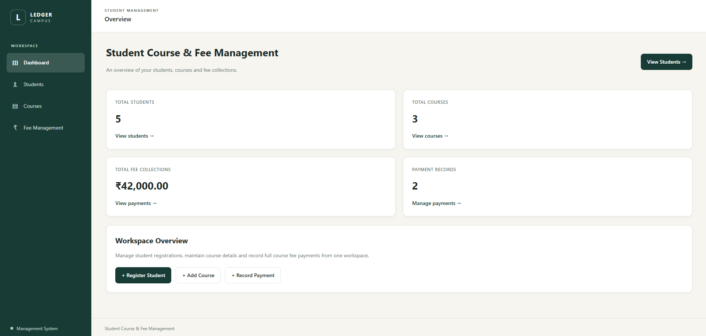
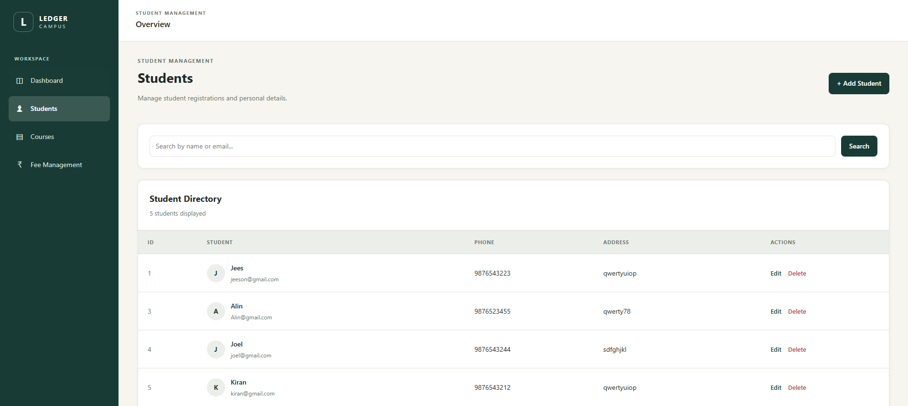
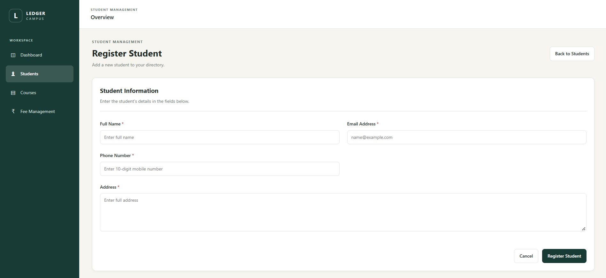
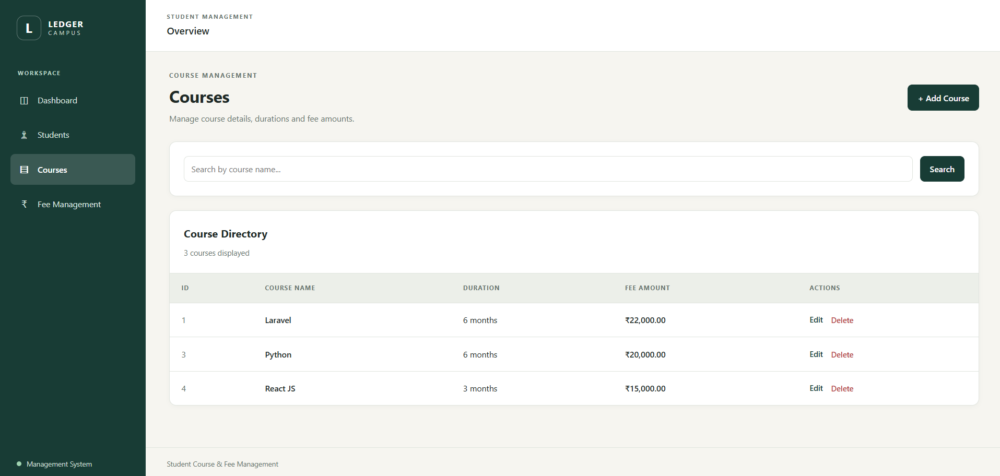
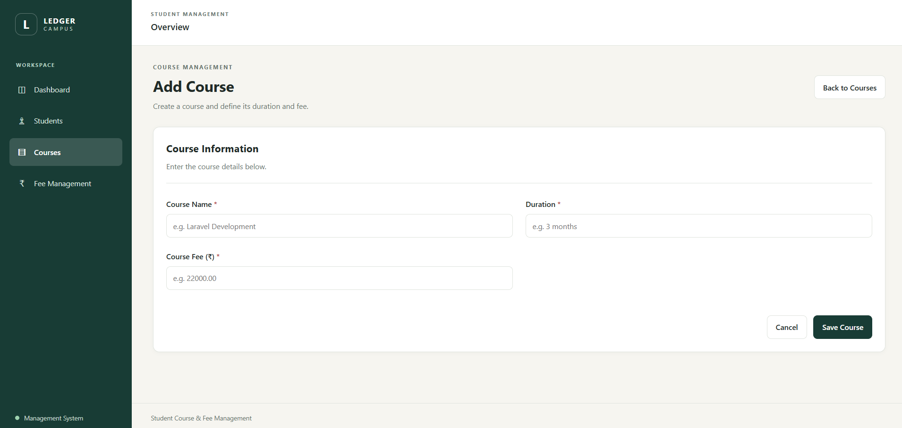
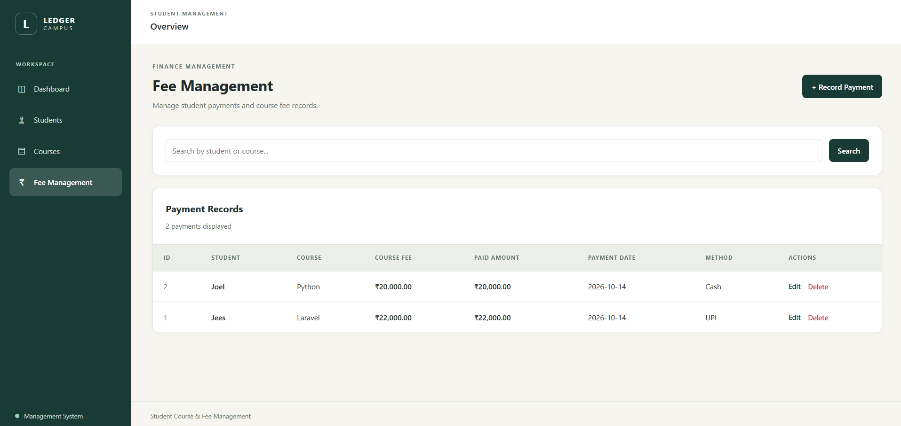
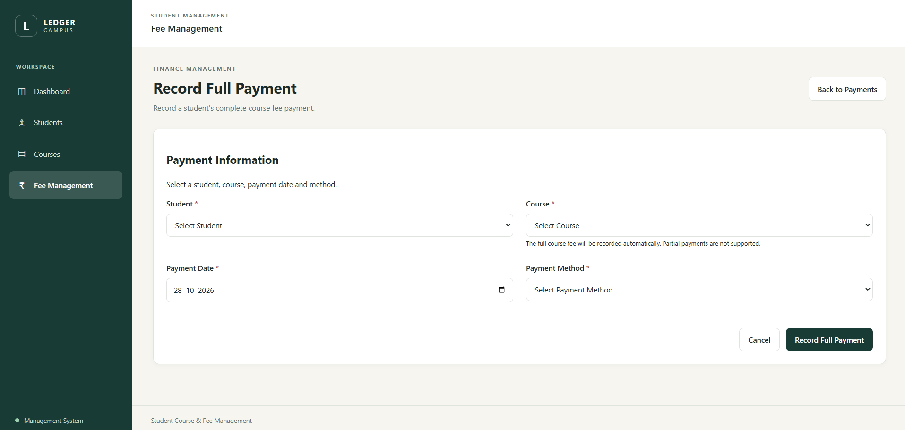

# Task 17 – Student Course & Fee Management System

## Overview

The Student Course & Fee Management System is a Laravel-based web application developed as part of my Full Stack Development Internship.

The project helps manage student records, courses, and fee payments through a structured interface. It focuses on database relationships, CRUD operations, validation, search functionality, and dashboard statistics.

## Objectives

* Implement CRUD operations for students, courses, and fee records.
* Understand relationships between students, courses, and fees.
* Use Laravel controllers and Eloquent models to organize application logic.
* Work with database migrations.
* Implement form validation and search functionality.
* Calculate and display fee-related information.
* Build a consistent and user-friendly interface.

## Task Requirements

### Task 17 – Student Course & Fee Management System

#### Project Overview

The **Student Course & Fee Management System** is a web-based application developed using Laravel. It provides a centralized platform to manage student registrations, course details, and fee payment records.

The application implements CRUD operations, Eloquent relationships, server-side validation, search functionality, and dashboard statistics. It also provides a clean, responsive, and user-friendly interface for managing student and financial information efficiently.

#### Objectives

- Manage student registrations and personal information.
- Maintain course details, durations, and fee amounts.
- Record and manage student course fee payments.
- Implement CRUD operations for all three modules.
- Establish database relationships using Laravel Eloquent ORM.
- Implement search functionality for students, courses, and fee records.
- Display important statistics through a centralized dashboard.

### Features & Functionalities

#### 1. Student Management

**Student Registration**
- Register students with the following details:
  - Name
  - Email
  - Phone Number
  - Address
- Store student information in the database.
- Apply validation rules to ensure valid student details.

**Student Listing**
- Display all registered students in a structured table.
- Include the following information:
  - Student Name
  - Email
  - Phone Number
  - Address
  - Actions (Edit/Delete)

**Search Functionality**
- Search students by name or email.
- Display only matching student records.

**Update Student Details**
- Edit and update existing student information.
- Validate the updated information before saving.

**Delete Student**
- Implement soft deletion to remove student records without permanently deleting them from the database.

#### 2. Course Management

**Course Registration**
- Add new courses with the following details:
  - Course Name
  - Duration
  - Fee Amount
- Store course information in the database.

**Course Listing**
- Display all available courses in a structured table.
- Include the following information:
  - Course Name
  - Duration
  - Fee Amount
  - Actions (Edit/Delete)

**Search Functionality**
- Search courses by course name.
- Display only matching course records.

**Update Course Details**
- Edit and update existing course information.

**Delete Course**
- Delete course records from the system.

#### 3. Fee Management

**Fee Payment**
- Record student course fee payments.
- Select a student from a dropdown list.
- Select a course from a dropdown list.
- Retrieve course fee information from the database.
- Record the following payment details:
  - Student
  - Course
  - Paid Amount
  - Payment Date
  - Payment Method

**Fee Payment Listing**

Display all fee payment records in a structured table, including:

- Student Name
- Course Name
- Course Fee
- Paid Amount
- Balance Amount
- Payment Date
- Payment Method
- Actions (Edit/Delete)

**Balance Calculation**

Balance Amount is calculated using the following formula:

`Balance Amount = Course Fee - Paid Amount`

**Search Functionality**
- Search fee payment records by student name or course name.
- Display only matching payment records.

**Update Fee Details**
- Edit and update existing payment information.

**Delete Fee Record**
- Delete fee payment records from the system.

#### 4. Dashboard Statistics

Provide a centralized dashboard displaying an overview of the system.

The dashboard includes:

- **Total Number of Students** – Displays the total registered students.
- **Total Number of Courses** – Displays the total available courses.
- **Total Fee Collections** – Displays the total amount collected from fee payments.
- **Total Number of Fee Records** – Displays the total number of recorded payment transactions.

Use Laravel Eloquent methods such as `count()` and `sum()` to retrieve dashboard statistics from the database.

### Technical Implementation

- **Backend:** PHP, Laravel
- **Frontend:** HTML, CSS, JavaScript, Blade Templates
- **Database:** MySQL
- **ORM:** Laravel Eloquent ORM
- **Architecture:** Model-View-Controller (MVC)

### Key Laravel Concepts Implemented

- Routing and Controllers
- Model-View-Controller (MVC) Architecture
- Database Migrations
- Eloquent ORM
- One-to-Many and Belongs-To Relationships
- CRUD Operations
- Form Validation
- Search Functionality
- Soft Deletes
- Blade Templates
- Session Flash Messages
- Dashboard Data Aggregation

---

**Project:** Internship Task 17 – Laravel Task 3  
**Application:** Student Course & Fee Management System  
**Framework:** Laravel  
**Database:** MySQL

## Key Features

### Student Management

* Manage student information.
* Create, view, edit, and delete student records.
* Support soft deletion for student records.

### Course Management

* Manage course information.
* Store course names, durations, and fee amounts.
* Create, view, edit, and delete courses.

### Fee Management

* Record student fee payments.
* Store payment amounts, dates, and payment methods.
* Associate fee records with students and courses.
* Validate payment information.
* Search fee records using student and course information.

### Dashboard

* Display management information and fee-related statistics.

### User Interface

* Use reusable Blade layouts.
* Maintain consistent styling across application pages.
* Provide separate pages for students, courses, and fees.

## Project Folder Structure

```text
Task17-Student-Course-Fee-Management/
├── app/
│   ├── Http/
│   │   └── Controllers/
│   │       ├── CourseController.php
│   │       ├── DashboardController.php
│   │       ├── FeeController.php
│   │       └── StudentController.php
│   └── models/
│       ├── Course.php
│       ├── Fee.php
│       └── Student.php
├── database/
│   └── migrations/
│       ├── 2026_09_17_095459_create_students_table.php
│       ├── 2026_09_17_095740_create_courses_table.php
│       ├── 2026_09_17_095754_create_fees_table.php
│       └── 2026_10_14_191822_add_unique_student_course_to_fees_table.php
├── public/
│   └── css/
│       └── style_t17.css
├── resources/
│   └── views/
│       ├── courses/
│       ├── fees/
│       ├── layouts/
│       └── students/
├── routes/
│   └── web.php
└── README.md
```

## Application Workflow

1. The user opens the application dashboard.
2. The user manages student and course records.
3. Fee payments are recorded against the relevant student and course.
4. The application validates submitted information.
5. Fee records can be searched and reviewed.
6. Dashboard statistics provide an overview of the available management data.

## Database Design

The application uses three main entities:

| Entity   | Purpose                                                   |
| -------- | --------------------------------------------------------- |
| Students | Stores student information                                |
| Courses  | Stores course details and fee amounts                     |
| Fees     | Stores fee payment records linked to students and courses |

The relationships between these entities support the management of student enrolments and their fee payments.

## Learning Outcomes

Through this task, I gained practical experience with:

* Laravel MVC architecture.
* Eloquent models and database relationships.
* Database migrations and schema changes.
* CRUD operations and form validation.
* Search functionality using database queries.
* Soft deletion.
* Blade layouts and interface styling.
* Building a database-driven management application.

## Screenshots

All screenshots are stored in `Assets/Screenshots/Week-10,11,12,13/Student-Course-Fee-Management/`.

### Dashboard



### Student Management



### Student Registration



### Course Management



### Add Course



### Fee Management



### Record Payment




## Conclusion

Task 17 builds on the Laravel fundamentals and CRUD concepts developed in earlier tasks. It provides practical experience in combining database relationships, validation, payment records, search functionality, and dashboard information in a structured web application.

---

**Project:** Laravel Student Course & Fee Management System
**Internship Phase:** Weeks 10–13
**Task:** 17

## Status

**Completed**


