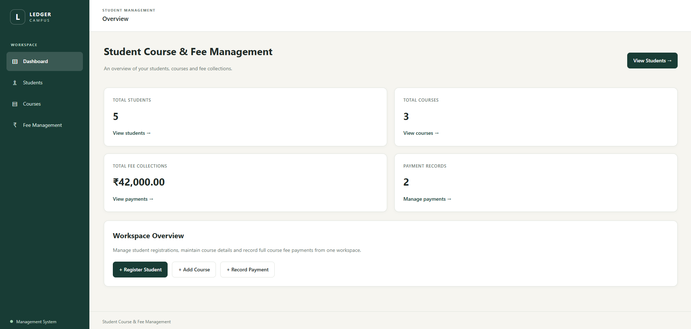
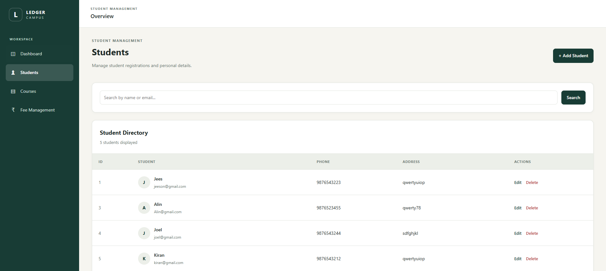
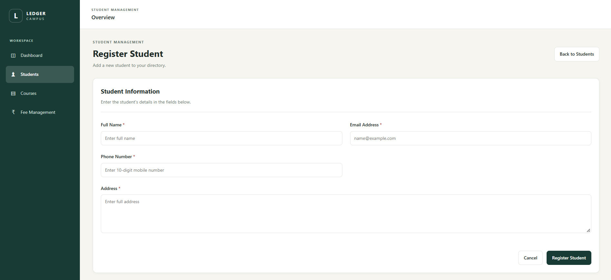
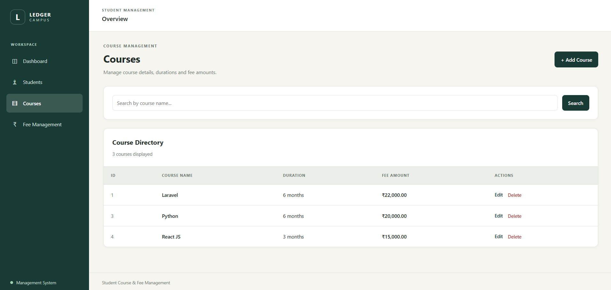
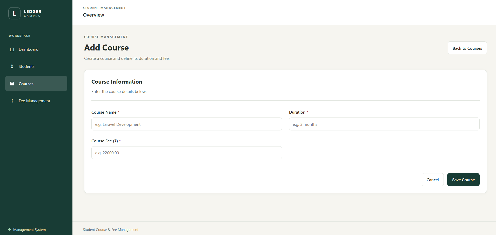
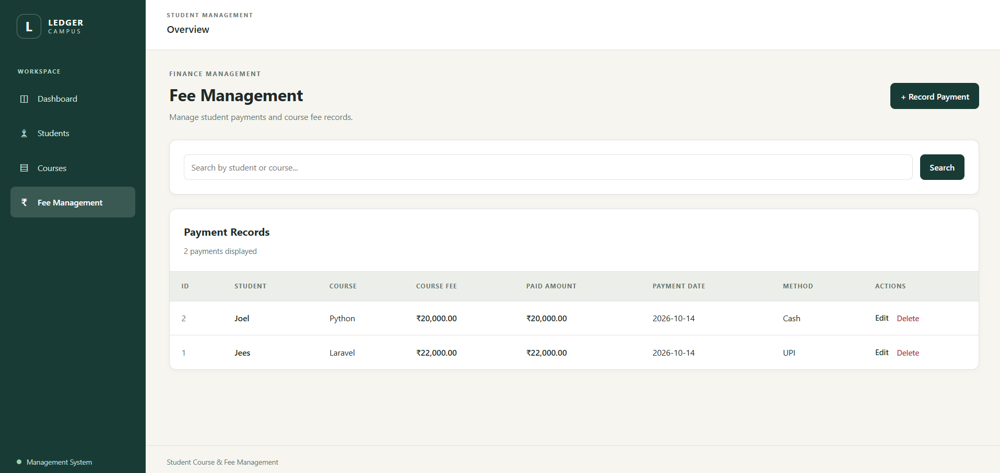
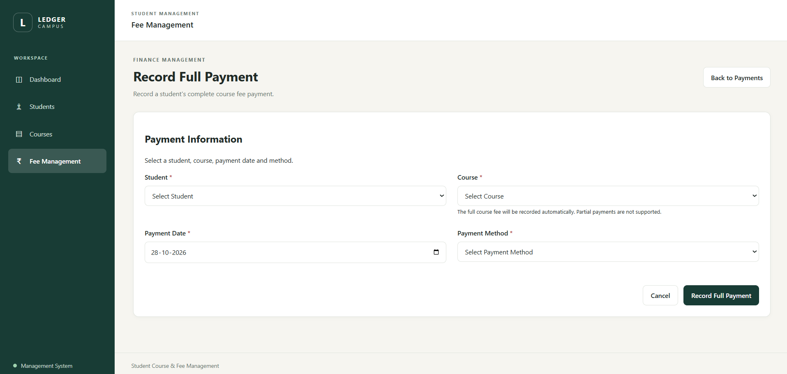

# Task 17 – Student Course & Fee Management System

## Overview

The Student Course & Fee Management System is a Laravel-based web application developed as part of my Full Stack Development Internship.

The project helps manage student records, courses, and fee payments through a structured interface. It focuses on database relationships, CRUD operations, validation, search functionality, and dashboard statistics.

## Objectives

* Implement CRUD operations for students, courses, and fee records.
* Understand relationships between students, courses, and fees.
* Use Laravel controllers and Eloquent models to organize application logic.
* Work with database migrations.
* Implement form validation and search functionality.
* Calculate and display fee-related information.
* Build a consistent and user-friendly interface.

## Technologies Used

* PHP
* Laravel
* MySQL
* Blade Templating Engine
* HTML
* CSS
* JavaScript

## Key Features

### Student Management

* Manage student information.
* Create, view, edit, and delete student records.
* Support soft deletion for student records.

### Course Management

* Manage course information.
* Store course names, durations, and fee amounts.
* Create, view, edit, and delete courses.

### Fee Management

* Record student fee payments.
* Store payment amounts, dates, and payment methods.
* Associate fee records with students and courses.
* Validate payment information.
* Search fee records using student and course information.

### Dashboard

* Display management information and fee-related statistics.

### User Interface

* Use reusable Blade layouts.
* Maintain consistent styling across application pages.
* Provide separate pages for students, courses, and fees.

## Project Folder Structure

```text
Task17-Student-Course-Fee-Management/
├── app/
│   ├── Http/
│   │   └── Controllers/
│   │       ├── CourseController.php
│   │       ├── DashboardController.php
│   │       ├── FeeController.php
│   │       └── StudentController.php
│   └── models/
│       ├── Course.php
│       ├── Fee.php
│       └── Student.php
├── database/
│   └── migrations/
│       ├── 2026_09_17_095459_create_students_table.php
│       ├── 2026_09_17_095740_create_courses_table.php
│       ├── 2026_09_17_095754_create_fees_table.php
│       └── 2026_10_14_191822_add_unique_student_course_to_fees_table.php
├── public/
│   └── css/
│       └── style_t17.css
├── resources/
│   └── views/
│       ├── courses/
│       ├── fees/
│       ├── layouts/
│       └── students/
├── routes/
│   └── web.php
└── README.md
```

## Application Workflow

1. The user opens the application dashboard.
2. The user manages student and course records.
3. Fee payments are recorded against the relevant student and course.
4. The application validates submitted information.
5. Fee records can be searched and reviewed.
6. Dashboard statistics provide an overview of the available management data.

## Database Design

The application uses three main entities:

| Entity   | Purpose                                                   |
| -------- | --------------------------------------------------------- |
| Students | Stores student information                                |
| Courses  | Stores course details and fee amounts                     |
| Fees     | Stores fee payment records linked to students and courses |

The relationships between these entities support the management of student enrolments and their fee payments.

## Learning Outcomes

Through this task, I gained practical experience with:

* Laravel MVC architecture.
* Eloquent models and database relationships.
* Database migrations and schema changes.
* CRUD operations and form validation.
* Search functionality using database queries.
* Soft deletion.
* Blade layouts and interface styling.
* Building a database-driven management application.

## Screenshots

All screenshots are stored in `Assets/Screenshots/Week-10,11,12,13/Student-Course-Fee-Management/`.

### Dashboard



### Student Management



### Student Registration



### Course Management



### Add Course



### Fee Management



### Record Payment




## Conclusion

Task 17 builds on the Laravel fundamentals and CRUD concepts developed in earlier tasks. It provides practical experience in combining database relationships, validation, payment records, search functionality, and dashboard information in a structured web application.

---

**Project:** Laravel Student Course & Fee Management System
**Internship Phase:** Weeks 10–13
**Task:** 17

## Status

**Completed**


