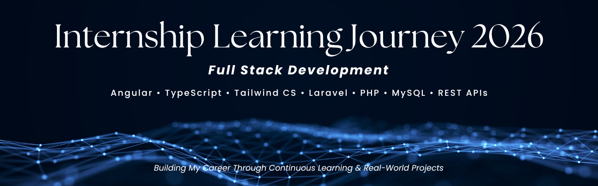

<p align="center">
  
</p>

# Internship Learning Journey 2026

---

## About

This repository documents my 6-month Full Stack Development Internship journey.

Throughout this internship, I am learning modern frontend and backend technologies while building practical applications, strengthening my programming skills, and documenting my progress through weekly reports, learning notes, and practical projects.

The repository is organized week by week to track my learning journey, project development, and progress toward becoming a Full Stack Developer.

---

## Repository Structure

```text
Internship-Learning-Journey-2026/
│
├── Assets/
│   ├── Banner/
│   └── Screenshots/
│       ├── Week-01/
│       ├── Week-02/
│       ├── Week-03/
│       ├── Week-04/
│       ├── Week-05,06/
│       └── Week-07,08,09/
│
├── Learning-Notes/
│   ├── HTML-CSS-JS/
│   ├── MySQL-Database/
│   ├── PHP/
│   ├── Laravel/
│   └── README.md
│
├── Projects/
│   ├── Week-01/
│   ├── Week-02/
│   ├── Week-03/
│   ├── Week-04/
│   ├── Week-05,06/
│   ├── Week-07,08,09/
│   └── README.md
│
├── Weekly-Progress/
│   ├── Week-01.md
│   ├── Week-02.md
│   ├── Week-03.md
│   ├── Week-04.md
│   ├── Week-05.md
│   ├── Week-06.md
│   ├── Week-07.md
│   ├── Week-08.md
│   ├── Week-09.md
│   └── README.md
│
└── README.md
```

---

# Quick Navigation

## Repository Sections

* 📂 [Projects](./Projects/)
* 📂 [Weekly Progress](./Weekly-Progress/)
* 📂 [Learning Notes](./Learning-Notes/)
* 📂 [Screenshots](./Assets/Screenshots/)

---

# Weekly Progress

* 📘 [Week 01 Progress Report](./Weekly-Progress/Week-01.md)
* 📘 [Week 02 Progress Report](./Weekly-Progress/Week-02.md)
* 📘 [Week 03 Progress Report](./Weekly-Progress/Week-03.md)
* 📘 [Week 04 Progress Report](./Weekly-Progress/Week-04.md)
* 📘 [Week 05 Progress Report](./Weekly-Progress/Week-05.md)
* 📘 [Week 06 Progress Report](./Weekly-Progress/Week-06.md)
* 📘 [Week 07 Progress Report](./Weekly-Progress/Week-07.md)
* 📘 [Week 08 Progress Report](./Weekly-Progress/Week-08.md)
* 📘 [Week 09 Progress Report](./Weekly-Progress/Week-09.md)
- 📘 [Week 10 Progress Report](./Weekly-Progress/Week-10.md)
- 📘 [Week 11 Progress Report](./Weekly-Progress/Week-11.md)
- 📘 [Week 12 Progress Report](./Weekly-Progress/Week-12.md)
- 📘 [Week 13 Progress Report](./Weekly-Progress/Week-13.md)

---

# Projects

## Week 01 — Frontend Fundamentals

* Task 01 – Profile Card
* Task 02 – Student Registration Form
* Task 03 – Student CRUD System
* Task 04 – Student CRUD Enhancement
* Task 05 – User Directory
* Task 06 – Weather Dashboard

## Week 02 — SQL and PHP Fundamentals

* Task 08 – SQL Database Basics
* Task 09 – SQL Database Operations
* Task 10 – SQL JOIN Operations

## Week 03 — PHP and MySQL Applications

* Task 11 & 12 – Student Management System (PHP + MySQL CRUD)
* Task 13 – Library Book Issue System
* Task 14 – Library Book Issue System Enhancement

## Week 04 — Laravel Fundamentals

* Introduction to the Laravel framework
* Laravel project structure and application flow
* MVC architecture
* Routing and controllers
* Introduction to Blade templating
* Artisan CLI fundamentals

## Weeks 05–06 — Laravel Task 15

**Task 15 – Laravel Profile Page**

* Profile information and interface
* Routing and controllers
* Blade templating
* Application structure and MVC concepts

## Weeks 07–09 — Laravel Task 16

**Task 16 – Student Registration CRUD System**

* Student registration form
* Student list and record display
* Editing student details
* Laravel routing and controllers
* Blade views
* CRUD application workflow

## Weeks 10–13 — Laravel Task 17

**Task 17 – Student Course & Fee Management System**

* Student, course, and fee management
* CRUD operations
* Student and course relationships
* Fee payment records
* Input validation and search
* Dashboard statistics

*Task-specific details should remain consistent with the actual implementation.*

---

# Learning Notes

* 📖 [HTML, CSS & JavaScript](./Learning-Notes/HTML-CSS-JS/)
* 📖 [MySQL Database](./Learning-Notes/MySQL-Database/)
* 📖 [PHP Fundamentals](./Learning-Notes/PHP/)
* 📖 [Laravel Fundamentals](./Learning-Notes/Laravel/README.md)
* 📖 [Laravel Task 16 Learning Notes](./Learning-Notes/Laravel/Task16-Laravel-task2-notes.txt)

---

# Technologies Covered

## Frontend

* HTML5
* CSS3
* JavaScript (ES6)

## Backend and Database

* PHP
* MySQL
* XAMPP
* phpMyAdmin

## Laravel Development

* Laravel 12
* MVC Architecture
* Routing and Controllers
* Blade Templating
* Artisan CLI
* CRUD Application Development
* Database Relationships
* Form Validation

## Next Learning Phase — Angular

* Angular 20
* TypeScript
* Angular Components and Templates
* Data Binding and Directives
* Services and Dependency Injection
* Angular Routing
* Forms and Validation
* HTTP Client and REST API Integration
* RxJS and Angular Signals
* Tailwind CSS

*These are planned learning topics for the upcoming Angular phase.*

## Upcoming Technologies

* REST API Development
* Laravel Sanctum
* Stancl Tenancy
* Laratrust

---

# Learning Roadmap

| Phase       | Planned Focus                                     | Status      |
| ----------- | ------------------------------------------------- | ----------- |
| Weeks 01–03 | Frontend fundamentals, SQL, PHP and MySQL         | ✅ Completed |
| Week 04     | Laravel fundamentals                              | ✅ Completed |
| Weeks 05–06 | Laravel Task 15 — Profile Page                    | ✅ Completed |
| Weeks 07–09 | Laravel Task 16 — Student Registration CRUD       | ✅ Completed |
| Weeks 10–13 | Laravel Task 17 — Student Course & Fee Management | ✅ Completed |
| Weeks 14–23 | Angular fundamentals and assigned tasks           | 🔜 Upcoming |
| Weeks 24–26 | Full Stack website development and integration    | 📌 Planned  |

*The roadmap represents the planned learning sequence. Weekly reports and project documentation reflect the corresponding work.*

---

# Internship Progress

| Week        | Status      | Topics Covered                                                                                   |
| ----------- | ----------- | ------------------------------------------------------------------------------------------------ |
| Week 01     | ✅ Completed | HTML, CSS, JavaScript, CRUD Operations, Local Storage and REST API Integration                   |
| Week 02     | ✅ Completed | DBMS, RDBMS, SQL, MySQL, SQL Queries, JOIN Operations and PHP Fundamentals                       |
| Week 03     | ✅ Completed | PHP, MySQL, CRUD Applications, SQL JOIN, Student Management System and Library Book Issue System |
| Week 04     | ✅ Completed | Laravel Framework Basics, MVC, Routing, Controllers and Blade Introduction                       |
| Weeks 05–06 | ✅ Completed | Laravel Task 15 — Profile Page                                                                   |
| Weeks 07–09 | ✅ Completed | Laravel Task 16 — Student Registration CRUD System                                               |
| Weeks 10–13 | ✅ Completed | Laravel Task 17 — Student Course & Fee Management System                                         |
| Weeks 14–23 | 🔜 Upcoming | Angular Learning and Assigned Tasks                                                              |
| Weeks 24–26 | 📌 Planned  | Full Stack Website Development                                                                   |

---

# Skills Gained

## Frontend Development

* HTML5
* CSS3
* JavaScript
* Responsive Web Design
* DOM Manipulation
* Form Validation
* Local Storage
* REST API Integration

## Database

* DBMS and RDBMS
* SQL and MySQL
* Database Design
* CRUD Operations
* Primary and Foreign Keys
* SQL JOIN Operations
* Aggregate Functions

## Backend Development

* PHP Syntax and Fundamentals
* Form Handling
* GET and POST Methods
* PHP and MySQL Integration
* CRUD Operations
* Dynamic Web Applications
* Relational Database Management

## Laravel Development

* Laravel Project Structure
* MVC Architecture
* Routing and Controllers
* Blade Templates
* Artisan CLI
* CRUD Application Development
* Database Relationships
* Validation and Search
* Laravel-Based Application Development

---

# Repository Highlights

* Weekly learning reports
* Practical internship projects
* Learning notes organized by technology
* Database scripts and practice files
* Project screenshots
* Consistent folder organization
* Documented learning roadmap

---

# Goals

* Strengthen frontend development skills.
* Improve backend development with PHP and Laravel.
* Build applications using Laravel and MySQL.
* Learn Angular and modern frontend development practices.
* Develop and integrate REST APIs.
* Understand authentication and authorization.
* Build a complete Full Stack project.
* Gain practical industry development experience.

---

# Connect With Me

### LinkedIn

https://www.linkedin.com/in/jeesonjustin

### GitHub

https://github.com/jeesonjustin
